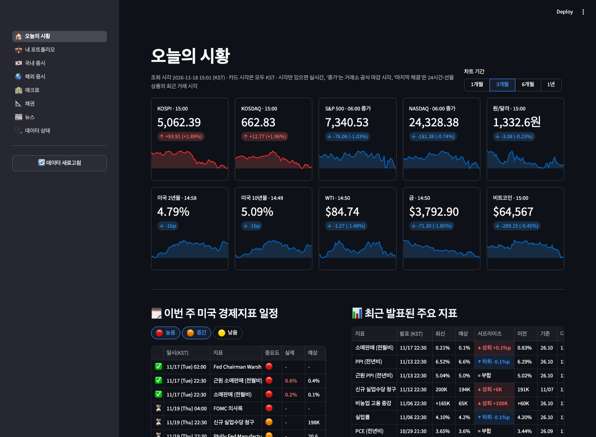
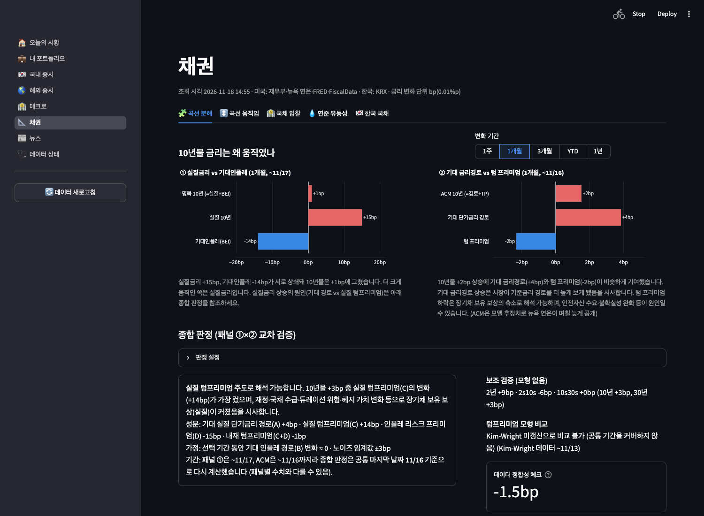
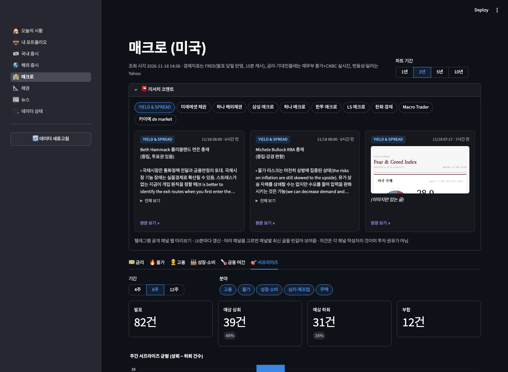

# 시황 대시보드 — 미국·한국 매크로·채권 중심

무료 공개 데이터만으로 만든 개인용 시장 대시보드입니다. 매크로·채권 분석에 쓰는 개념(수익률 곡선 분해, 곡선 국면, 국채 입찰 수요, 연준 유동성, 경제지표 서프라이즈)을 데이터로 직접 계산하고, 해석 규칙은 코드와 테스트로 남겼습니다.



## 화면 구성

| 화면 | 내용 |
|---|---|
| 오늘의 시황 | **아침 시황 원문 카드**(월~금: 한화 리서치 텔레그램의 미국 채권·주식·환율 아침 시황, 토·일: @ehdwl의 FICC 부분 + 대시보드 숫자 줄, AI 없이 원문 그대로 · 공개 모드에선 숫자·제목·링크만), 주요 지수·환율·금리·원자재 카드(실시간 또는 종가 시각 표시, 차트 기간 기본 **1일**: 장 시작~마감 고정 축에 현재 위치·전일 종가선, 1주는 최근 5거래일 장중), **오늘의 이슈**(뉴스 헤드라인을 AI가 국내·해외 이슈로 묶고 기사 수로 화제성 표시), **리서치 코멘트 요약**(채권·매크로 텔레그램 6개 채널 → 논점·금리 방향·출처), **바이사이드 관점**(로컬 전용, 시장 텔레그램 5개 채널 → 사후 설명 대신 논지·시장 반영과의 차이·확인/반증 신호), 이번 주 미국 경제지표 일정(예상·실제)과 국내 주요 일정(한은 금통위·수출입동향), 최근 발표 지표의 컨센서스 대비 서프라이즈 |
| 국내 증시 | 한화 마감 시황 원문 카드, **지수 카드**(KOSPI·KOSDAQ·코스피 200, 1년 범위·기간 변화·미니 차트), **투자자별 매매동향**(외국인·기관·개인 순매수, 프로그램, 최근 20거래일), **🎲 선물·옵션**(코스피 200 선물·베이시스, 선물 투자자별 순매수 20일, 옵션 만기 D-day), 업종 등락·시가총액 상위 히트맵(네이버 업종별 묶음)·등락률·거래대금 상위·ETF (**장중엔 네이버 실시간**, KRX 공개 후엔 KRX 공식 종가, 1주 이상 업종 수익률은 KRX 업종 지수) |
| 미국 증시 | **🌐 24시간 시세**(하이퍼리퀴드 XYZ 무기한 선물: S&P 500·나스닥100·코스피 200·닛케이·EWY·엔비디아·SK하이닉스·삼성전자 등·금·원유, 직전 정규장 마감 대비로 월요일 갭 가늠, 주말엔 오늘의 시황에도 펼침), **🌙 미국장 마감 시황 원문**(평일 한화 ★ 주식 아침 시황, 토·일 @ehdwl '한국 증시 관련 수치'), **지수 카드**(S&P 500·나스닥·다우·러셀 2000) + **지수 선물**(한국 낮에 보는 미국 분위기), S&P 500 대형주 히트맵, **시장 폭**(대형주 중 50·200일선 위 비율, '좁은 장' 경고), **대형주 시세표**(히트맵 종목 + TSMC·SOXL·SOXS, 전일 종가 대비·기준 시각, 프리마켓·애프터마켓 시세, 1분 자동 갱신), **🎲 변동성·포지션**(VIX 기간구조·VIX/VIX3M 백워데이션 경고, SKEW·VVIX, CFTC S&P 500 선물 자산운용사·레버리지 펀드 순포지션, 옵션 만기 D-day), **대형주 실적 발표 일정**(예정: 장 전·장 후와 한국 시간, 최근: 서프라이즈), 섹터 ETF, 스타일 상대강도, 지수 비교 |
| 매크로 | **🧠 최근 발표 해석**(CPI·PCE·고용·GDP·소매판매·PPI·JOLTS·ISM 발표 30분 뒤 AI가 결과·의미·연준/금리 함의·시장 반응을 "~음/~함" 체 4줄로, 숫자는 입력값과 대조 검증, 텔레그램 전송), **🧭 매크로 국면**(성장 = CFNAI 3개월 평균 × 물가 = 근원 PCE 3개월 연율 − 2% 사분면과 12개월 궤적, 규칙 기반), 통화정책(기준금리 범위·다음 FOMC D-day, **FOMC 회의별 인상·동결·인하 확률**(CME FedWatch 방식을 30일 연방기금금리 선물로 직접 계산), 2년물−기준금리)·물가(3·6개월 연율, 근원 상품·주거·주거 제외 서비스)·고용(삼 법칙, 자발적 이직률)·성장(GDPNow, CFNAI)·금융여건, 카드에 발표 시각·다음 발표 D-day·예상 대비 배지, 탭마다 **발표 현황 보드**(지표 한 줄에 전월비·전년비, 예상 대비 상회·하회 색, 이전 값, 기준 기간, 발표 시각(KST)·최근 발표 표시, 다음 발표 D-day · **⚡속보**: FRED 반영 전엔 Nasdaq 발표치를 먼저 보여주고 발표 시간대엔 2분 캐시·1분 자동 새로고침), 경제지표 서프라이즈 이력과 성장·물가 누적 서프라이즈 |
| 채권 | **원문 박스**(미 국채 = 한화 ★ 채권 아침 시황·주말 @ehdwl FICC 국채금리 문단, 국고채 = 한화 ★ 채권 마감 시황), **맨 위 금리 요약**(미 2·10·30년, 2s10s, 10년 실질금리·BEI 카드 + 2주 안 채권 이벤트: 입찰·CPI·고용·PCE·금통위), **10년물 AI 판단**(매일 08:30, 1주·1개월, 규칙 기반 분해를 근거로 맥락까지 읽고 '~음/~함' 체로 판단 · 규칙과 일치 여부·이후 금리 변화 기록), 10년물 분해(실질+BEI / 기대경로+텀프리미엄)와 교차 판정, **수급·포지션**(CFTC 레버리지 펀드·SOFR−IORB·MOVE·입찰 약세로 '정보에 의한 재가격 vs 포지션 정리' 판정), 곡선 국면 분류, 국채 입찰 수요 평가, 연준 순유동성, 한국 국고채 |
| 뉴스 | 국내·해외 RSS 통합, **주제 태그·필터**(금리·채권·중앙은행·물가·환율·증시·반도체·원자재·관세·지정학, 주제 없는 기사는 기본 숨김), **같은 사건 묶기**('외 N건'), 맨 위 오늘의 이슈(AI) 연결, 키워드 검색 |
| 데이터 상태 | 소스별 신선도 점검, 수집기 실행 기록 |
| 내 포트폴리오 | 거래·배당 기록 → 이동평균 단가, 실현·평가 손익, 시간가중수익률(로컬 전용, 공개 배포 시 숨김) |

| 채권 | 매크로 서프라이즈 |
|---|---|
|  |  |

## 데이터 소스 (모두 무료)

| 소스 | 용도 | 비고 |
|---|---|---|
| FRED (REST) | 경제지표, 크레딧 스프레드, 연준 대차대조표, ALFRED 빈티지 | API 키 필요(무료) |
| 미 재무부 수익률 곡선 CSV | 명목·실질(TIPS) 국채 종가 | 키 불필요 |
| CFTC TFF (Socrata API) | 레버리지 펀드 국채 선물 포지션 | 화요일 기준·금요일 발표 |
| CNBC 시세 | 국채 금리 실시간 | 비공식, 실패 시 재무부 → FRED로 대체 |
| TreasuryDirect | 국채 입찰 결과·예정 | FiscalData가 2026-10 말 갱신을 멈춰 교체 |
| 뉴욕 연은 ACM | 텀 프리미엄 | 며칠 늦게 공개 |
| Nasdaq 경제 캘린더 | 컨센서스·실제치 | 비공식, 조회 날짜가 하루 밀려 있어 보정 |
| 한국은행 홈페이지 | 금통위(통화정책방향 결정회의) 일정 | 공개 페이지, 하루 한 번 |
| Nasdaq 실적 캘린더 | 대형주 실적 발표 일정·EPS 서프라이즈 | 비공식, 빈 응답은 캐시하지 않음 |
| ForexFactory | 이번 주 미국 일정·중요도 | 무료 피드는 이번 주만 제공 |
| Yahoo Finance | 해외 지수·ETF·원자재·환율, 30일 연방기금금리 선물(FOMC 확률) | |
| 네이버 증권 | 국내 지수(실시간), 장중 종목·업종·ETF 순위, 투자자별 매매동향 | 비공식 모바일 API, 실패 시 KRX 전 거래일로 대체 |
| KRX 정보데이터시스템 | 국내 종목·업종·ETF·국고채 | API 키 필요(무료, 서비스별 승인) |
| 하이퍼리퀴드 공개 API | 주말·휴장 24시간 시세 (XYZ 시장만, 조회 전용) | 실제 지수·주식이 아닌 무기한 선물 |
| RSS / 텔레그램 웹 미리보기 | 뉴스(국내 4곳, 해외 CNBC·WSJ·MarketWatch·FT·Investing.com·Nasdaq, 연준·ECB·한국은행), 공개 리서치 채널 | |
| 구글 뉴스 검색 RSS | 로이터·블룸버그 헤드라인 (공개 RSS가 없어 제목 키워드 검색) | 제목만, 링크는 구글 뉴스 경유 |

## 만들면서 찾고 검증한 문제들

기능보다 이 부분이 이 프로젝트에서 가장 많이 배운 부분입니다.

1. **FRED는 정말 늦는가** — ALFRED 빈티지로 각 관측값이 처음 올라온 날을 공식 발표일과 비교해, 월간 지표는 발표 당일 반영(지연 0일)임을 확인했습니다. 늦는 것은 시장 가격 계열(H.15 국채, 달러지수 등)이라 그 부분만 재무부·CNBC·Yahoo로 바꿨습니다.
2. **셧다운으로 빠진 달이 만든 CPI 오류** — 2025년 10월 CPI가 발표되지 않아 순서 기준 `pct_change(12)`가 13개월 전과 비교해 CPI 전년비가 3.40%가 아닌 3.69%로 표시됐습니다. 날짜 기준 변환(`data/fred.py: transform`)으로 바꾸고 원계열(NSA) 기준으로 통일했습니다.
3. **시간대 버그** — KST 자정 이후 미국 날짜보다 하루 앞선 '오늘'을 FRED에 넘겨 400 오류가 나며 컨센서스가 사라졌습니다. FRED·Nasdaq 기준 날짜를 미국 시간으로 계산합니다.
4. **10년물 분해의 모순 해소** — 실질+BEI 패널과 기대경로+텀프리미엄 패널을 따로 해설하면 결론이 충돌합니다. 명목 = A+B+C+D 프레임에서 'ΔB≈0' 가정으로 성분을 풀고, 가정 위반(R4)은 대안 가정 분해로 진단하는 교차 판정을 만들었습니다(`data/bond_attribution.py`, 테스트 26개). 이 프레임에는 TIPS 유동성 프리미엄이 빠져 있어 2020년 3월 같은 경색 국면의 BEI 급락을 인플레 리스크 프리미엄 하락으로 잘못 읽으므로, HY 스프레드·MOVE가 급등하면 '유동성 왜곡 가능' 경고를 띄웁니다.
5. **조용히 멈추는 데이터** — Yahoo 국내 지수 일봉 NaN, iCloud 동기화로 멈춘 수집기, 갱신이 멈춘 FiscalData 입찰 데이터처럼 에러 없이 옛날 값을 보여주는 장애가 반복돼, 소스별 '마지막 데이터 나이'를 점검하고 변화가 있을 때만 알리는 상태 점검을 붙였습니다(`data/health.py`).
6. **컨센서스 매칭** — ForexFactory와 Nasdaq의 지표 이름이 달라(`ISM Services PMI` ↔ `ISM Non-Manufacturing PMI`) 같은 시각(±5분)·이전치·예상치·이름 유사도로 매칭합니다.

## 실행

```bash
pip install -r requirements.txt
cp .env.example .env        # FRED_API_KEY, KRX_API_KEY 입력
streamlit run app.py        # http://localhost:8501
```

- 수집기(3시간마다 CSV 누적 + 상태 점검 알림): `python collect.py`, 자동 실행 등록 `zsh scripts/install_collector.sh`
- 대시보드 자동 실행(macOS 로그인 시): `zsh scripts/install_dashboard.sh`
- AI 요약(오늘의 이슈·리서치 코멘트·바이사이드 관점, 하루 2회 08:30·16:00 — 맥이 꺼져 있었거나 인터넷 없이 실패하면 30분마다 따라잡기, 로그인된 Claude Code `claude -p` 사용 · 도구 없음 · 출처 id 검증): `python summarize.py`, 자동 실행 등록 `zsh scripts/install_summarizer.sh`
- 휴대폰 알림·발표 해석(이례적 변동 ⚡ 알림, 미 국채 2년·10년 큰 변동 알림(하루 ±8/12/16bp · 30분 ±4bp · 10Y−2Y 하루 ±6bp, 그 시각 발표 지표 함께), 🧠 발표 해석, 10분마다 점검·같은 항목은 하루 한 번, 해석은 `claude -p` 사용): `.env`에 `TELEGRAM_BOT_TOKEN`·`TELEGRAM_CHAT_ID` 입력 후 `python alerts.py --test`, 자동 실행 등록 `zsh scripts/install_alerts.sh`
- 테스트: `pip install -r requirements-dev.txt && python -m pytest`

## 공개 배포 (Streamlit Community Cloud)

Secrets에 `FRED_API_KEY`, `KRX_API_KEY`, `PUBLIC_MODE = "1"`을 넣습니다. 공개 모드에서는 내 포트폴리오·데이터 상태 화면이 빠지고, 텔레그램 글은 앞부분과 원문 링크만 보입니다. `.env`, `portfolio/`, `collected/`, `.cache/`는 저장소에 포함되지 않습니다.

## 구조

```
app.py            진입점·메뉴
config.py         키·캐시 주기·채널 목록 (.env 또는 Streamlit Secrets)
collect.py        주기 수집 + 상태 점검 알림
summarize.py      AI 요약: 뉴스 이슈 + 텔레그램 리서치 + 바이사이드 관점 (하루 2회 08:30·16:00), 10년물 판단 (08:30)
data/             소스별 수집·계산 (fred, rates, bonds, bond_attribution, surprise, krx, health …)
views/            화면
ui.py             공용 차트·카드
tests/            해석 로직 단위 테스트
scripts/          launchd 등록 스크립트
```

## 주의

개인 학습·포트폴리오용입니다. 투자 권유가 아니며, 일부 소스(CNBC, Nasdaq, 텔레그램 웹 미리보기)는 비공식 경로라 예고 없이 바뀔 수 있습니다.
